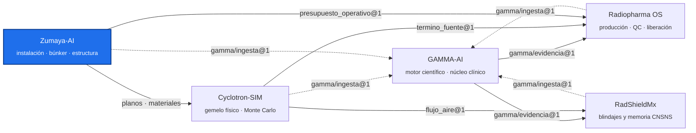

<!-- encabezado-gamma -->
<div align="center">

# Zumaya-AI

**Proyecto de la instalación: Centro Internacional de Neuro-Oncología Zumaya (Villahermosa, Tabasco)**

  

[Qué aporta](#qué-aporta) · [Recintos y estado del diseño](#recintos-y-estado-del-diseño) · [Fuentes](#fuentes) · [Sustento científico](#sustento-científico) · [Integración con el ecosistema](#integración-con-el-ecosistema) · [Ecosistema GAMMA](#ecosistema-gamma)

</div>

> [!IMPORTANT]
> Repositorio privado, de uso individual del titular. Los espesores y presupuestos son de diseño; la autorización la otorga la CNSNS.
<!-- /encabezado-gamma -->

Zumaya-AI es el proyecto del **Centro Internacional de Neuro-Oncología Zumaya** (Villahermosa,
Tabasco): el edificio real del ecosistema. Reúne los planos, los blindajes de cada recinto, el Monte
Carlo de la bóveda del ciclotrón, la estructura preliminar, la geotecnia y el presupuesto operativo
con el que se diseñó cada blindaje.

## Qué aporta

- **La instalación concreta.** Las demás plataformas son generales; aquí están las medidas, los
  materiales y las cargas del edificio que se va a construir y operar.
- **Cada espesor con su fuente.** La base de blindajes guarda el md5 de cada documento usado.
- **Un límite de operación explícito.** El presupuesto operativo (corriente y µA·h por semana) es
  el supuesto del blindaje; Radiopharma OS planea la producción sin rebasarlo.

## Recintos y estado del diseño

| Recinto | Estado |
|---|---|
| Ciclotrón IBA KIUBE (doble haz, 2 × 150 µA) | Espesores interinos de tabique TD-250 por Monte Carlo: este 2.08 m, oeste 1.95 m, sur 1.82 m, techo 1.95 m; definitivos al cerrar el MC F90 |
| Ventilación de la bóveda | Ar-41 bajo el DAC ~45 min tras apagar el haz con 10 renovaciones/h (~21 min con 20) |
| Linac Versa HD 15 MV | Muros cortos con TD-550; pendientes laberinto y puerta |
| Gamma Knife, HDR, PET-CT, medicina nuclear, CT simulador | Estimaciones de blindaje con fuente; pendientes puertas HDR y PET |
| Estructura | Búnkeres sobre pilas (capacidad superficial 4.9–5.5 t/m²) |

## Fuentes

| Carpeta | Contenido |
|---|---|
| `fuentes/planos` | Planos DWG (BIND 28-10-26 y planta baja 31-10-26) |
| `fuentes/ciclotron_IBA` | Propuesta y Site Requirement Guide del KIUBE |
| `fuentes/tabiques` | Fichas Contuplex TD-250 a TD-550 e informes IMCYC de TM-Nipol |
| `fuentes/geotecnia` | Estudio de mecánica de suelos (OD Ingeniería, 2025) |
| `fuentes/blindaje_GAMMA` | Estimaciones de blindaje de GAMMA Consultoría |

## Sustento científico

NCRP 147 y 151, AAPM TG-108, IAEA SRS-47 y la guía de sitio de IBA para los cálculos analíticos
(hechos en RadShieldMx); Geant4 11.4 con física QGSP_BIC_HP para el Monte Carlo de la bóveda
(hecho en Cyclotron-SIM); fichas certificadas IMCYC para densidad y composición de tabiques.

## Integración con el ecosistema

| Con | Contrato | Uso |
|---|---|---|
| Radiopharma OS | `zumaya-ai/presupuesto_operativo@1` (`licencia/presupuesto_operativo.json`: 300 µA, 12 000 µA·h/semana) | Límite de producción |
| Cyclotron-SIM | planos y materiales | Geometría y composición del búnker para el MC |
| RadShieldMx | planos y presupuesto | Cálculo analítico, memoria CNSNS y ventilación |
| GAMMA-AI | `gamma/ingesta@1` (`gamma-ingesta.json`) | Indexa `fuentes/` e `informes/` |

## Estructura

```
blindaje/        base de blindajes, pipelines y evidencia por fase
analisis_plano/  extracción DWG → DXF (LibreDWG + ezdxf) y figuras
mc_ciclotron/    configuraciones y resultados del MC de la bóveda
estructural/     análisis estructural preliminar
licencia/        presupuesto operativo
informes/        informes de blindaje en PDF
fuentes/         documentos fuente
herramientas/    manifiesto para GAMMA
```

## Uso

```bash
cd blindaje/pipelines && python -m pytest -q
python herramientas/manifiesto_gamma.py      # regenera gamma-ingesta.json
```

## Colaboraciones

Abierto a colaboradores invitados del proyecto: arquitectura, ingeniería estructural y de
instalaciones, y física médica para la revisión de blindajes.

## Hoja de ruta

1. Cerrar el MC F90 y fijar los espesores definitivos del búnker.
2. Composición química del TD-250 (análisis en proceso) para el MC.
3. Laberinto y puerta del linac, puertas HDR y PET, distribución de la radiofarmacia.
4. Cargas del blindaje al cálculo estructural definitivo.

## Ecosistema GAMMA

Cinco repositorios privados unidos por contratos JSON versionados, no por imports. Este repositorio
está resaltado.



## Confidencialidad y licencia

Software propietario de uso individual del titular; no es de código abierto ni se distribuye.
Los documentos fuente son propiedad del titular, que tiene los derechos de uso. Ningún dato de
pacientes reales entra a este repositorio: los datos clínicos permanecen anonimizados y fuera de
GitHub. Las salidas técnicas no sustituyen la revisión ni la firma del profesional responsable.
