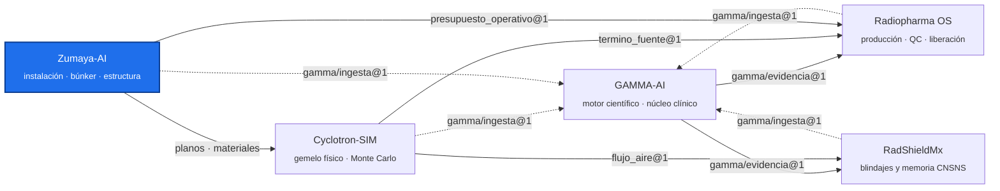

<!-- encabezado-gamma -->
<div align="center">

# Zumaya-AI

**Proyecto de la instalación: Centro Internacional de Neuro-Oncología Zumaya (Villahermosa, Tabasco)**

  

[Objetivos](#objetivos) · [Estructura](#estructura) · [Contratos](#contratos) · [Estado (01-11-2026)](#estado-01-11-2026) · [Ejecutar](#ejecutar) · [Ecosistema GAMMA](#ecosistema-gamma)

</div>

> [!IMPORTANT]
> Repositorio privado, de uso interno. Los documentos son propiedad del usuario, que tiene los derechos de uso. Los espesores y presupuestos son de diseño; la autorización la otorga la CNSNS.
<!-- /encabezado-gamma -->

Repositorio del proyecto de la instalación:
- blindajes del ciclotrón, el linac, el Gamma Knife, la braquiterapia HDR, el PET-CT, medicina
  nuclear y el CT simulador;
- análisis de planos y Monte Carlo de la bóveda;
- análisis estructural preliminar y geotecnia;
- informes y documentos fuente.

Es el «edificio» del ecosistema GAMMA: aporta los datos de la instalación a Cyclotron-SIM,
Radiopharma OS y RadShieldMx, y sus documentos se indexan en GAMMA-AI.

## Objetivos

1. **Blindaje de cada recinto con su fuente.** La base `blindaje/datos/bd_blindaje_zumaya.json`
   guarda el md5 de cada documento usado.
2. **Validar el ciclotrón con MC.** Se usa el MC de la bóveda del KIUBE, calibrado contra la SRG de
   IBA en Cyclotron-SIM, en lugar de sólo fórmulas analíticas.
3. **Fijar el presupuesto operativo** (corriente y µA·h por semana) con el que se diseñó el
   blindaje, para que la producción no lo rebase.

## Estructura

| Carpeta | Contenido |
|---|---|
| `fuentes/planos` | DWG BIND 28-10-26 y planta baja 31-10-26 (con contraventeos) |
| `fuentes/blindaje_GAMMA` | Estimaciones de blindaje de GAMMA Consultoría (oncología y ciclotrón) |
| `fuentes/tabiques` | Fichas CONTUPLEX TD-250/350/400/500/550 e informes IMCYC OT-521 (TM-NIPOL densidad 3.5, 4 y 5) |
| `fuentes/geotecnia` | Estudio de mecánica de suelos, OD Ingeniería (2025) |
| `fuentes/ciclotron_IBA` | Propuesta IBA y Site Requirement Guide del KIUBE |
| `blindaje/datos` | Base de blindajes con el md5 de cada fuente |
| `blindaje/pipelines` | Fases F86–F89 (Python) y pruebas |
| `blindaje/evidencia` | Salidas JSON por fase |
| `rpos_fases_zumaya` | F81–F83: plantas BIND y documentos de blindaje (vienen de Radiopharma OS) |
| `analisis_plano` | Extracción DWG→DXF (LibreDWG 0.13 + ezdxf) y figuras |
| `mc_ciclotron` | Configuraciones y resultados del MC de la bóveda (F89; F90 en Cyclotron-SIM) |
| `licencia` | `presupuesto_operativo.json` (contrato `zumaya-ai/presupuesto_operativo@1`) |
| `informes` | PDF de los informes de blindaje (BIND, F89, F90), Excel del linac TD-550 y seguimiento |
| `rpos_fases` | Parches originales F86–F89 (referencia) |
| `herramientas` | `manifiesto_gamma.py` → `gamma-ingesta.json` |

## Contratos

| Archivo | Contrato | Consumidor |
|---|---|---|
| `licencia/presupuesto_operativo.json` | `zumaya-ai/presupuesto_operativo@1`: KIUBE 300 µA (doble haz 2 × 150 µA en T1/T5), **12 000 µA·h/semana**. Supuesto de diseño, a fijar en la licencia CNSNS | Radiopharma OS (plan de producción) |
| `gamma-ingesta.json` | `gamma/ingesta@1` (16 documentos) | GAMMA-AI (corpus científico) |

## Estado (01-11-2026)

- **Ciclotrón.** F90 con doble haz y sin puertas blindadas; el MC está en curso en Cyclotron-SIM
  (57 de 88 lotes). Espesores interinos de tabique TD-250:

  | Cara | Espesor interino |
  |---|---|
  | Este | 2.08 m |
  | Oeste | 1.95 m |
  | Sur | 1.82 m |
  | Techo | 1.95 m (convergido) |

  Pendientes: composición del TD-250 (el análisis químico está en proceso) y documentos de IBA.
- **Ventilación de la bóveda.** Con el flujo del MC a 300 µA y 2 h de irradiación, el Ar-41 baja
  del DAC:
  - unos 45 min después de apagar el haz, con 10 renovaciones/h;
  - unos 21 min, con 20 renovaciones/h.

  El cálculo está en RadShieldMx.
- **Linac Versa HD 15 MV.** Muros cortos todavía con TD-550 = 5.5 m. Falta pesar las piezas.
- **Estructura.** Los búnkeres van sobre pilas (qa superficial de 4.9–5.5 t/m²). El linac no
  tiene junta constructiva.
- **Pendientes de otras áreas.** Puerta HDR Co-60, puerta y laberinto del linac, layout de la
  radiofarmacia y puertas PET.

## Ejecutar

Python 3.12 o superior, sin contenedores propios. El MC corre en el contenedor de Cyclotron-SIM.

```bash
cd blindaje/pipelines && python -m pytest -q
cd rpos_fases_zumaya && python -m pytest -q
python herramientas/manifiesto_gamma.py      # regenera gamma-ingesta.json
```

Las rutas por defecto están dentro del repo y se pueden cambiar con `ZUMAYA_BD`, `ZUMAYA_LOSA`,
`ZUMAYA_MC_IBA` y `RPOS_EVIDENCIA`.

## Relación con otros repos

- **Cyclotron-SIM:** modelo del KIUBE y MC de la bóveda (F90).
- **Radiopharma OS:** planea la producción contra `presupuesto_operativo@1`.
- **RadShieldMx:** cálculo analítico, memoria CNSNS y ventilación.
- **GAMMA-AI:** indexa `fuentes/` e `informes/`; las demás plataformas citan desde ahí.

## Ecosistema GAMMA

Cinco repositorios privados unidos por contratos JSON versionados, no por imports. Este repositorio
está resaltado.



## Confidencialidad y licencia

Software propietario de uso individual del titular; no es de código abierto ni se distribuye.
Los documentos fuente son propiedad del titular, que tiene los derechos de uso. Ningún dato de
pacientes reales entra a este repositorio: los datos clínicos permanecen anonimizados y fuera de
GitHub. Las salidas técnicas no sustituyen la revisión ni la firma del profesional responsable.
